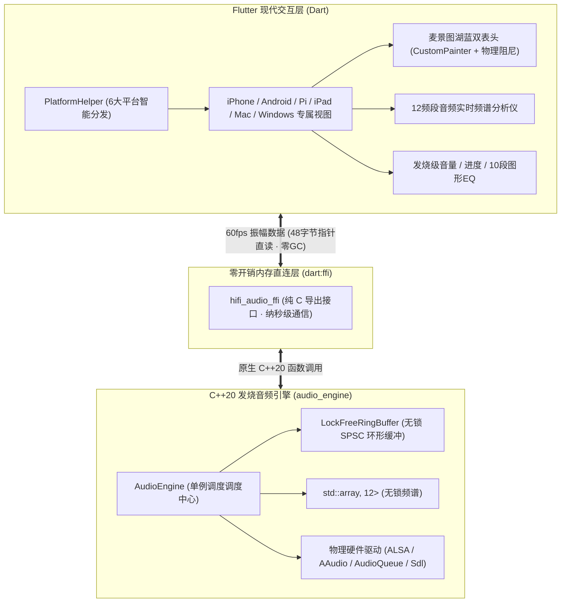

> 当前分支与引擎的接入规则见 [分支职责](doc/branch_ownership.md)。音频源码统一维护在本仓库的 `dev/audio_engine`，通过 `audio_engine.lock.json` 锁定使用。

# 🎵 MyHiFiPlayer - Flutter 发烧级全平台数播前级交互系统

本项目是配合 **C++20 发烧级纯音音频内核 (`audio_engine`)** 的全新 **Flutter 跨平台交互客户端**。

覆盖 7 大运行平台：
* 📱 **iPhone** (单手竖屏高信息密度、灵动岛与安全区自适应、触控弹性滑动)
* 🤖 **Android** (AAudio 底层直出、Material 3 响应式、高刷低延迟)
* 🥧 **树莓派 5 (Raspberry Pi 5)** (Linux-Lite 纯终端环境、微雪 7 寸 QLED 1024×600 触控屏无桌面直启、开机秒进麦景图双表头)
* 📟 **iPad** (平板双栏 Master-Detail 曲库分栏、巨幅发烧表头)
* 🖥️ **macOS** (CoreAudio Hog Mode 独占直通、Bit-Perfect 384kHz/32Bit 状态展示)
* 🪟 **Windows** (WASAPI 独占、桌面发烧音响工作台)

---

## 🏗️ 系统拓扑架构与音画分离设计



---

## 📁 目录组织规范

```text
hide_player_flutter/
├── lib/
│   ├── main.dart                  # 应用主入口，动态分发至各端专属视图
│   ├── core/
│   │   ├── hifi_audio_bindings.dart # dart:ffi 底层动态库绑定
│   │   ├── hifi_audio_service.dart  # 全局 60fps 响应式音频状态调度服务
│   │   └── platform_helper.dart     # 多端平台识别与开发期即时预览切换器
│   ├── models/
│   │   ├── track.dart               # 音乐曲目元数据
│   │   └── playback_state.dart      # 播放器实时状态与频谱
│   ├── theme/
│   │   └── hifi_theme.dart          # 麦景图湖蓝、金嗓子琥珀金、暗黑深邃玻璃主题
│   └── ui/
│       ├── shared/                  # 跨端通用发烧组件 (VU双表头/频谱仪/控制条)
│       ├── iphone/                  # iPhone 专属竖屏沉浸视图
│       ├── android/                 # Android 专属 Material 3 视图
│       ├── pi/                      # 树莓派 7寸 QLED (1024×600) 横屏发烧台机视图
│       ├── ipad/                    # iPad 大屏双栏 Master-Detail 视图
│       ├── mac/                     # macOS 专业窗口桌面视图
│       └── window/                  # Windows 桌面视图
│
├── native/                          # C++ 原生发烧内核与 FFI 导出层
│   ├── CMakeLists.txt               # 跨平台 CMake 动态库构建脚本
│   ├── include/hifi_audio_ffi.h     # 纯 C 头文件 (导出供 Flutter 调用的接口)
│   ├── src/hifi_audio_ffi.cpp       # C++ 包装实现
│   └── audio_engine/                # 100% 继承自原项目的发烧音频内核
│
└── doc/                             # 架构设计与平台部署指南
    ├── architecture.md              # 深度架构设计与无锁 FFI 直连机制
    ├── development_guide.md         # 开发环境与全平台构建指南
    └── pi_development_handover.md   # 树莓派 5 专属台机布局与开发交接权威记录
```

---

## ⚡ 树莓派 5 (Linux-Lite) 无桌面全屏自启运行

在纯终端、无 X11、无桌面的 Raspberry Pi OS Lite 上，利用极简单屏混成器 `cage` 直接拉起 Flutter，实现无桌面直通：

```bash
# 1. 树莓派安装极简混成器
sudo apt update && sudo apt install -y cage

# 2. 开机全屏免密直启 (写入 systemd 服务)
cage -s -- /home/winheo/pi-hifi-flutter/build/linux/arm64/release/bundle/hide_player_flutter
```
* **开机速度**：约 6-7 秒直入麦景图湖蓝双表头；
* **内存占用**：约 140MB（树莓派 5 1GB 内存仅占用 14%，850MB 充裕空间保障音频解码缓冲）；
* **流畅度**：4 核 Cortex-A76 硬件加速，稳锁 60fps。

---

## 🛠️ 本地快速构建与运行

### 1. 编译 C++ 原生动态库
```bash
cd native
cmake -B build -DCMAKE_BUILD_TYPE=Release
cmake --build build -j$(nproc 2>/dev/null || sysctl -n hw.ncpu)
```

### 2. 运行 Flutter App
```bash
flutter pub get
flutter run -d macos
```
在 Mac 上运行时，右上角配有浮动切换器，可一键实时预览 iPhone、iPad、树莓派 7寸屏、Android 等各个平台的专属 UI！
