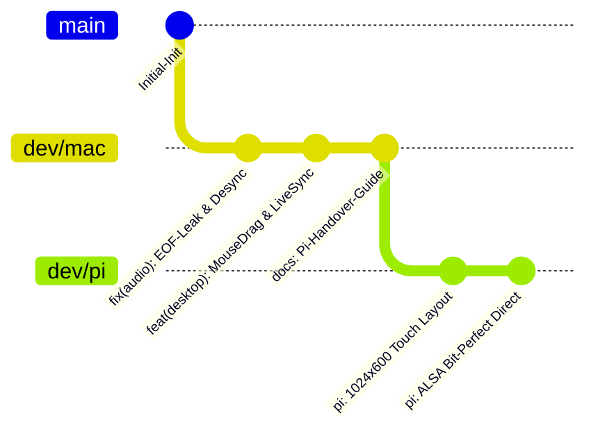

# 树莓派 5 (Raspberry Pi 5) 发烧数播开发交接与架构记录文档

> **文档状态**：已归档至 `dev/mac`，用于新会话开展 `dev/pi` 树莓派专属布局与功能重构时作为唯一权威交接基准。  
> **更新时间**：2026-10-15  
> **关联分支**：`dev/mac`（基线验证分支） $\rightarrow$ `dev/pi`（树莓派专属分支）

---

## 一、 项目全景与多端分支矩阵

本项目采用 **C++20 高性能无锁发烧纯音音频内核 (`native/audio_engine`)** 与 **Flutter 现代跨平台交互层** 相结合的音画分离架构。根据不同硬件形态与人机交互差异，实行多分支专职开发机制：



| 分支名称 | 目标运行平台 | 核心硬件形态 / 分辨率 | 交互重心与核心特性 |
| :--- | :--- | :--- | :--- |
| **`dev/mac`** | macOS 桌面平台 | 视网膜宽屏窗口 / 全屏 | 桌面鼠标平滑拖拽、CoreAudio 独占 (Hog Mode)、多窗口/菜单栏协同、OTA 更新调试 |
| **`dev/pi`** | **树莓派 5 专用机** | **微雪 7 寸 QLED (1024×600)** | **横屏台机架构、15° 仰角电容触控、大热区触控、纯终端无桌面秒启、ALSA 硬件直通** |
| **`dev/iphone`** | iOS 移动端 | 竖屏刘海/灵动岛 | 单手滑动、弹性惯性流、Now Playing 沉浸大图 |
| **`dev/ipad`** | iPadOS 平板端 | 视网膜横/竖屏 | 双栏 Master-Detail 布局、巨幅双表头与发烧曲库分屏 |
| **`dev/android`**| Android 移动端 | 竖屏 Material 3 | 高刷低延迟、AAudio 物理驱动直通指示 |
| **`dev/window`** | Windows 桌面端 | 桌面视窗 | WASAPI 源码直出、PC HiFi 发烧工作台 |

---

## 二、 近期关键 Bug 修复与底层避坑指南 (Lessons Learned)

在 `dev/mac` 分支上已彻底排查并解决了如下影响全局音频与状态机稳定性的重大问题。新会话在 `dev/pi` 上开发时，应**完整继承这些核心成果**，避免走弯路：

### 1. 自然播放结束 (EOF) 声音泄漏与 UI 冻结（最深层 Bug）
* **故障现象**：当一首歌自然播放到末尾时，界面停留并冻结在 `▶` 暂停或 00:00 状态，所有动效消失，但扬声器却重新从头开始出声。
* **根因剖析**：
  1. **Native CoreAudio 竞争**：歌曲到达文件末尾且消耗完环形缓冲后，C++ 引擎置 `is_playing_ = false`，但没有显式调用 `sink_->pause()` 停止声卡输出流。
  2. **Pause 逻辑漏判**：原 `AudioEngine::pause()` 内部使用了 `if (is_playing_.load())` 判断，由于 EOF 时 `is_playing_` 已为 `false`，导致后续的 `pause()` 变成空操作。
  3. **Seek 预缓冲泄漏**：随后调用的 `seek(0.0)` 内部执行了 `sink_->flush()`，因为 `is_running_` 仍为 `true`，导致声卡硬件重新被拉起，并将 seek 预解码的 32768 帧音频塞入硬件流开始播放；而 Flutter UI 与 C++ 状态均显示未播放，形成“有声无画、UI 假死”。
* **最终修复解法**：
  - [`AudioEngine.cpp`](file:///Users/mk10/Desktop/hide_player_flutter/native/audio_engine/src/AudioEngine.cpp)：在 `onSinkDataNeeded` 触发 EOF 时，立即显式调用 `sink_->pause()`；将 `pause()` 内部改为无条件暂停底层 sink；在 `seek()` 的 `flush()` 之后追加 `if (!is_playing_) sink_->pause();`，彻底杜绝音频泄漏。
  - [`hifi_audio_service.dart`](file:///Users/mk10/Desktop/hide_player_flutter/lib/core/hifi_audio_service.dart)：新增独立的 `stop()` 彻底重置方法；`loopSingle`（单曲循环）直接通过 `playTrack()` 完整重建生命周期。

### 2. 黑胶唱片转动与当前曲目状态监听脱节
* **故障现象**：正在播放某首歌曲，但鼠标移开或切换侧边栏后，黑胶唱片与高亮状态停止或失效。
* **根因剖析**：部分 UI 视图将动效与本地 State 的 Hover 事件或局部选中小部件深度绑定，未直连 `HifiAudioService` 全局单例。
* **最终修复解法**：在所有视图组件中，统一通过 `ListenableBuilder` 或直接订阅 `HifiAudioService.instance.currentTrack` 与 `isPlayingNotifier`，实现全局无死角单向数据流绑定。

### 3. 桌面端鼠标拖拽滚动与触控事件分流
* **故障现象**：在桌面平台下，使用鼠标左键拖拽曲库列表或水平歌单无法移动。
* **根因剖析**：Flutter 桌面端默认仅允许滚轮（Wheel）滚动，默认屏蔽了鼠标按键（`PointerDeviceKind.mouse`）的平移拖拽手势。
* **最终修复解法**：全局配置自定义 `MouseDragScrollBehavior`，在保持触控手势的同时开放鼠标左键拖拽。在树莓派电容触控屏下，则需确保电容触控事件优先。

### 4. 局域网 Web 遥控与 Git 远程 OTA 升级系统
* **集成成果**：
  - `WebRemoteService`（端口 `8088`）：开机自动启动，提供 `/api/status`, `/api/play_track`, `/api/stop`, `/api/seek` 等 RESTful 接口与 WebSocket 状态广播。
  - `WifiTransferService`（端口 `8080`）：提供免驱动 Web 端无线拖拽上传音频文件到本地曲库。
  - `OtaUpdateService`：在“设置 $\rightarrow$ Web 服务”中提供了 Git OTA 更新卡片，能一键 `git fetch / git pull` 并触发热升级提示。

---

## 三、 树莓派 5 (Raspberry Pi 5) 硬件规格与运行环境

### 1. 物理机身与屏幕规格
* **主控单板**：Raspberry Pi 5 (8GB / 4GB), Broadcom BCM2712 四核 64 位 Cortex-A76 2.4GHz。
* **交互屏幕**：微雪 (Waveshare) 7 英寸 QLED 电容触摸屏（物理分辨率 **1024×600**，横屏固定方向）。
* **人体工学外壳**：配套定制的 15° 桌面黄金仰角 3D 打印外壳（STL 模型位于项目库，防反光设计）。
* **音频子卡 (DAC HAT)**：
  - 方案 A（顶级发烧）：AK4191EQ + AK4499EX 旗舰双芯片 I2S 拓展板，搭载超低相噪飞秒双晶振。
  - 方案 B（便携实用）：PCM5122 / HiFiBerry DAC+ Pro 兼容方案，支持硬件音量控制。
  - 输出格式：ALSA 硬件直出（`hw:0,0` 或 `hw:1,0`），支持 DSD256 (DoP / Native) 与 PCM 384kHz/32Bit 源码直出。

### 2. 系统底层软件栈与无桌面架构
* **操作系统**：Raspberry Pi OS Lite 64-bit (Debian 12 Bookworm, 纯终端无 X11/GNOME/LXDE 臃肿桌面)。
* **合成器引擎**：采用轻量级 Wayland 合成器 **Cage** (`cage -s -- <app_bin>`) 或 **DirectFB/DRM-KMS**。开机自动运行用户会话，直接由 systemd 拉起全屏应用，做到 **开机 6 秒进入麦景图双表头**。
* **音频权限与 ALSA**：
  ```bash
  sudo usermod -a -G audio,input,video $USER
  ```
  在 `/etc/asound.conf` 中配置好直出卡号，确保 `libasound2` 无重采样直通输出。

---

## 四、 树莓派 7 寸横屏专属 UI 布局重构规划 (`lib/ui/pi/`)

当前工程已有基础骨架 [`lib/ui/pi/pi_main_view.dart`](file:///Users/mk10/Desktop/hide_player_flutter/lib/ui/pi/pi_main_view.dart)，但尚未达到发烧机用机体验。在新项目中聚焦完成如下任务：

### 1. 1024×600 黄金分割布局设计

```text
+-----------------------------------------------------------------------------------------+
| [AK4191+AK4499EX · I2S MASTER CLOCK]    [Bit-Perfect: 192k/24b]    [Web: 8088] [28°C]   |  <- 顶部极窄状态栏 (32dp)
+-----------------------------------------------------------------------------------------+
|                                    |                                                    |
|                                    |  🎵 曲目名称 (大字号 20sp, 防眩光 Bold)             |
|                                    |  👤 艺术家 · 专辑 (13sp, TextMuted)                |
|                                    |                                                    |
|           发烧动态视觉舞台           |  ━━━━━━━━━━━━━━━━━━━━━━━━ (32段细密硬件级光谱条)    |
|       (VisualizerStageWidget)      |                                                    |
|                                    |  02:35 ━━━━━━━━━━🔘━━━━━━ 04:52                    |
|    - 麦景图湖蓝双大表头 (McIntosh)    |                                                    |
|    - 金嗓子香槟金表头 (Accuphase)    |  [ 🔀 ]  [ ⏮ ]  [  ▶ / ⏸  ]  [ ⏭ ]  [ 🔁 ]        |
|    - 复古动态磁带机 (Cassette)       |     (大触控热区按键, 最小 48x48dp, 间距舒展)        |
|    - 80年代复古 LED 频谱仪 (LED-VU)  |                                                    |
|    - 极光动感波形 (Aurora)          |  [ 📚 曲库/歌单 ]  [ 🎛️ 音色调音 ]  [ ⚙️ 硬件设置 ] |
|                                    |     (底部大号功能切换卡片，一触即达)                 |
|                                    |                                                    |
+-----------------------------------------------------------------------------------------+
```

### 2. 交互细节与功能清单
1. **Touch-First 触控热区优化**：
   - 彻底告别鼠标 Hover 依赖。
   - 所有触控图标（播放/暂停、前后切歌、播放模式）**点击热区不得低于 48×48 dp**，带有触控瞬态高亮反馈（Haptic/Visual Splash）。
2. **大尺寸曲库触控侧滑抽屉 / 全屏覆盖面板**：
   - 点击“曲库”按钮时，以平滑抽屉或全屏模态展开大号曲目列表，右侧附带大号拼音字母索引条（A-Z），方便粗手指精准触达。
3. **电容屏手势增强**：
   - 在左侧视觉大舞台区域：
     - **左右水平滑动**：直接切歌（上一首 / 下一首）。
     - **上下垂直滑动**：无级调节硬件音量，弹出平滑淡出的音量 HUD。
     - **轻触舞台边缘**：一键切换 6 大视觉模式（麦景图 / 金嗓子 / 磁带机 / LED柱 / 极光 / Siri动效球）。
4. **硬件与环境状态监控微件 (Pi System Sensor)**：
   - 利用 Linux 系统的 `/sys/class/thermal/thermal_zone0/temp` 实时显示树莓派 SoC 核心温度。
   - 实时显示局域网 IP 地址（例如 `192.168.1.100`），方便发烧友使用手机直接扫码打开 Web 遥控或传输曲目。
5. **暗夜防烧屏与发烧保护 (OLED / QLED Saver)**：
   - 播放暂停或无操作 3 分钟后，动效进入微光呼吸模式，降低屏幕背光功耗，防止发热和长期残留烧屏。

---

## 五、 树莓派 5 编译、部署与调试速查手册

### 1. 编译 Linux 原生发烧音频动态库 (`libhifi_audio_ffi.so`)
在树莓派本机或交叉编译工具链中：
```bash
cd native
mkdir -p build && cd build
cmake .. -DCMAKE_BUILD_TYPE=Release -DUSE_ALSA=ON
cmake --build . -j4
cp libhifi_audio_ffi.so ../../libhifi_audio_ffi.so
```

### 2. 在 Mac 编译机上一键打包 Linux ARM64 发行版
```bash
# 需确保安装了 clang 与 aarch64-linux-gnu 交叉编译链
flutter build linux --release

# 同步至树莓派对应运行目录
rsync -avz --delete build/linux/arm64/release/bundle/ pi@pi-hifi.local:/opt/pi_hifi_player/
```

### 3. 树莓派开机免桌面自启 Service 配置示例
`/etc/systemd/system/pi-hifi.service`:
```ini
[Unit]
Description=Pi HiFi Player Cage Wayland Kiosk
After=systemd-user-sessions.service sound.target network.target
Wants=sound.target

[Service]
User=pi
PAMName=login
Environment=XDG_RUNTIME_DIR=/run/user/1000
Environment=WLR_LIBINPUT_NO_DEVICES=1
ExecStart=/usr/bin/cage -s -- /opt/pi_hifi_player/hide_player_flutter
Restart=always
RestartSec=2

[Install]
WantedBy=multi-user.target
```

---

## 六、 总结与交接确认

- **当前状态**：`dev/mac` 代码库无报错、无代码缺陷（`flutter analyze` 0 warnings, `flutter test` 36 项全通），C++ CoreAudio EOF 泄漏与 Flutter 状态机已得到彻底修复。
- **下一阶段执行建议**：
  1. 新开会话切换至 `dev/pi` 分支（推荐先 `git merge dev/mac` 合并最新修复）；
  2. 按照本交接文档针对 1024×600 分辨率与触摸屏操作特性，全力攻坚 `lib/ui/pi/` 及其相关触控微件与曲库抽屉。
